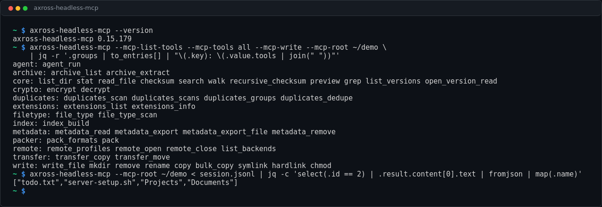

<!-- mcp-name: io.github.c0decave/axross-headless-mcp -->
# axross-headless-mcp

*axross's headless MCP server: file tools on the local disk and on SFTP, SMB, WebDAV, S3 and more for any MCP client, over stdio or HTTP - without Qt.*



- **Your files for any MCP client** - Claude Desktop, Claude Code, Cursor, VS Code: list, read, search and hash files.
- **Almost every file system** - the local disk, SFTP built in, and 40 backends from SMB, NFS and S3 to cloud drives, Git and databases as extras.
- **Read-only by default** - the write tools only with `--mcp-write` and an explicit `--mcp-root`.
- **Confined to one folder** - every path stays under `--mcp-root`; SSH and GnuPG keys and tokens are refused.
- **50+ tools in groups** - metadata, duplicates, archives, crypto, file types, transfers, remote profiles and more.
- **stdio or HTTP** - streamable HTTP with a bearer token, mTLS for anything but loopback.
- **No GUI, no Qt** - runs on a server, in a container or in CI: `pipx`, `uvx` or Docker.
- **Current MCP** - 2025-11-25: tool annotations, structured results, progress, cancellation, resources.
- **An audit trail** - what each tool did or refused, on stderr and in the log.
- **The same code as axross** - axross's settings and saved connection profiles, credentials from the keyring.

## Contents

- **[Everything in detail: the extended README](https://github.com/c0decave/axross-headless-mcp/blob/main/docs/README-extended.md)**
- [What changed: the CHANGELOG](https://github.com/c0decave/axross-headless-mcp/blob/main/CHANGELOG.md)
- [What it supports and does](#what-it-supports-and-does)
- [Install](#install)
- [Connect a client](#connect-a-client)
- [Documentation](#documentation)
- [Tests](#tests)
- [Licence](#licence)

## What it supports and does

- **Almost every file system:** the local disk plus 40 backends - protocols, cloud services, devices.
- **Classic network storage:** SFTP, SCP, SMB / CIFS with DFS namespaces, NFS, WebDAV, FTP / FTPS, rsync, iSCSI.
- **Object storage and the cloud:** S3 and S3-compatible stores, Azure Blob and Files, OneDrive, SharePoint, Google Drive, Dropbox.
- **Code and data as folders:** Git and Subversion repositories, PostgreSQL, SQLite, Redis, MongoDB GridFS, LDAP.
- **Devices and mail:** Android (ADB, MTP), IMAP, POP3, Exchange (EWS), NNTP, TFTP, Gopher, printers (PJL), WinRM, WMI, Cisco IOS.
- **The same tools everywhere:** listing, reading, searching, hashing and previews work alike on every backend.
- **Your saved connections:** axross's connection profiles, credentials from the system keyring, never shown to the model.
- **Read-only by default:** writing, moving and deleting need `--mcp-write` and an explicit `--mcp-root`.
- **Confined to one folder:** every path stays under `--mcp-root`, checked through the folder's own descriptors.
- **Secrets stay put:** SSH and GnuPG keys, tokens and `.env` files are refused; every stream is scanned for keys.
- **52 tools in 14 groups, opt in:** only the core tools are on until you name more groups or `all`.
- **Search and grep across servers:** name, size and date search, content grep, an offline index for repeated searches.
- **Checksums without downloading:** SHA-256 on the server where the backend offers it, recursive checksums of whole trees.
- **Duplicate finder:** duplicate groups by wasted space, dedupe to the trash, every copy re-verified first, a dry run by default.
- **Metadata, read and removed:** EXIF / GPS / XMP / IPTC, Office and PDF properties, media tags; removal writes a cleaned copy.
- **Archives, safely:** list and extract zip, tar.*, 7z and rar, guarded against zip-slip, bombs, link members and spoofing names.
- **Packing:** zip, tar.gz / .zst / .xz / .bz2 and 7z, optionally AES-256 with encrypted file names.
- **Encryption:** encrypt and decrypt files (AES-256-GCM, PBKDF2-SHA256).
- **File types by content:** magic-byte detection that flags files whose extension lies.
- **Copy and move between any two backends:** SFTP to S3, SMB to Google Drive - atomic, resumable, never half-written under the final name.
- **Earlier versions:** list and read previous versions where the storage keeps them.
- **Remote commands, only if allowed:** SSH, WinRM (PowerShell), ADB and more with `--mcp-allow-exec`, off by default.
- **Current MCP over stdio or HTTP:** protocol 2025-11-25, 2025-06-18, 2024-11-05; bearer token, mTLS off loopback, an audit trail.
- **Runs anywhere, no GUI:** `uvx`, `pipx` or the container image; the same code as the axross desktop app and its tests.

**The 52 tools** (only the file tools are on until `--mcp-tools GROUP,...` or `all` adds groups): **files (always on)** `list_directory`, `get_path_info`, `read_file`, `compute_file_checksum`, `search_index`, `walk_tree`, `compute_tree_checksums`, `render_preview`, `search_content`, `list_file_versions`, `read_file_version`; **write (`--mcp-write`)** `write_file`, `create_directory`, `delete_path`, `move_path`, `copy_file`, `copy_tree`, `create_symlink`, `create_hardlink`, `set_permissions`; **metadata** `read_metadata`, `export_metadata`, `strip_metadata`; **duplicates** `scan_duplicates`, `list_duplicate_scans`, `list_duplicate_groups`, `trash_duplicates`; **archives** `list_archive_formats`, `create_archive`, `list_archive_members`, `extract_archive`; **crypto** `encrypt_file`, `decrypt_file`; **file types** `identify_file_type`, `scan_file_types`; **index** `build_index`; **transfers** `copy_path_to_backend`, `move_file_to_backend`; **remote profiles** `list_remote_profiles`, `open_remote_profile`, `close_remote_profile`, `list_backends`; **remote commands (`--mcp-allow-exec`)** `run_backend_command`, `run_backend_script`; **scripts (`--mcp-allow-scripts`)** `list_scripts`, `get_script_api`, `read_script`, `write_script`, `delete_script`, `run_script`; **agent** `run_llm_agent`; **extensions** `list_extensions`.

## Install

```sh
pipx install axross-headless-mcp            # or: pip install axross-headless-mcp
pipx install 'axross-headless-mcp[all]'     # with every remote protocol and format
axross-headless-mcp --mcp-list-tools --mcp-tools all   # what it would serve, as JSON
```

## Connect a client

```sh
claude mcp add axross -- axross-headless-mcp --mcp-root ~/projects --mcp-tools all
```

Claude Desktop, Cursor, VS Code and other clients: [the JSON
configuration](https://github.com/c0decave/axross-headless-mcp/blob/main/docs/README-extended.md#connect-a-client-stdio). Over HTTP (a bearer token, mTLS off
loopback): [Over HTTP](https://github.com/c0decave/axross-headless-mcp/blob/main/docs/README-extended.md#over-http). In a container:

```sh
docker run -i --rm -v "$PWD:/data" ghcr.io/c0decave/axross-headless-mcp:latest \
    --mcp-server --mcp-root /data --mcp-tools all
```

## Documentation

| Page | What it covers |
|---|---|
| [Extended README](https://github.com/c0decave/axross-headless-mcp/blob/main/docs/README-extended.md) | every tool group, the protocol, HTTP, Docker, settings |
| [docs/MCP.md](https://github.com/c0decave/axross/blob/main/docs/MCP.md) | the full reference of axross's MCP server |
| [docs/mcp-tools.json](https://github.com/c0decave/axross/blob/main/docs/mcp-tools.json) | the tool catalogue, generated from the manifest |
| [llms-install.md](https://github.com/c0decave/axross-headless-mcp/blob/main/llms-install.md) | setup steps for AI agents (Cline and others) |

## Tests

```sh
python -m pytest tests
```

## Licence

Apache-2.0, as [axross](https://github.com/c0decave/axross): the same code, written out by axross's
`scripts/export_standalone.py`. Everything in detail: the [extended README](https://github.com/c0decave/axross-headless-mcp/blob/main/docs/README-extended.md).
